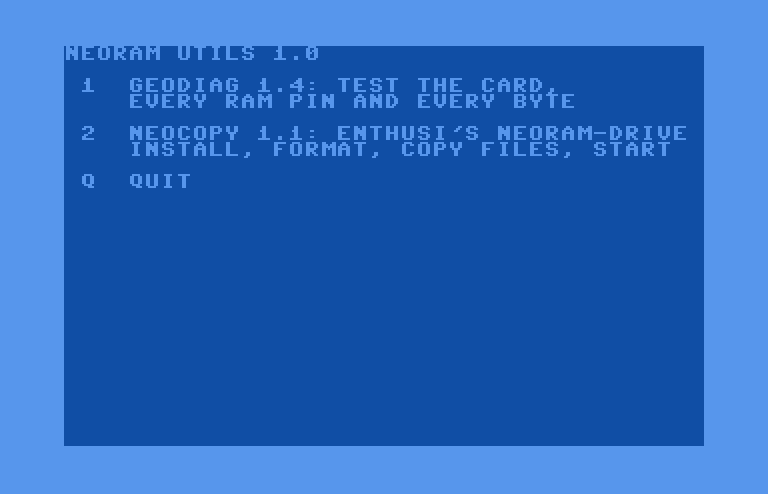
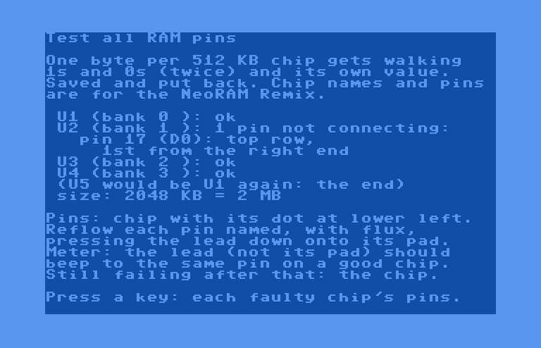
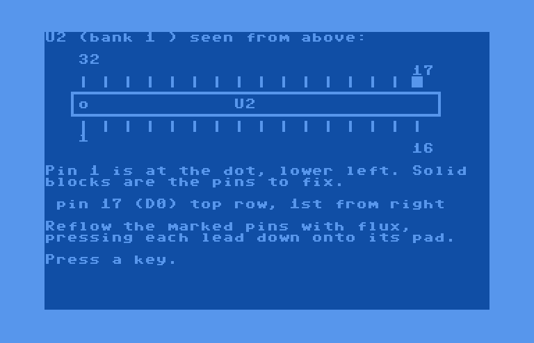
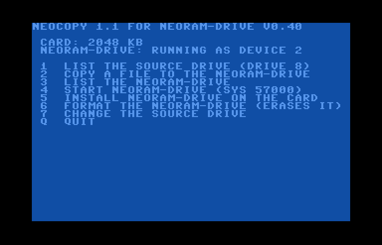
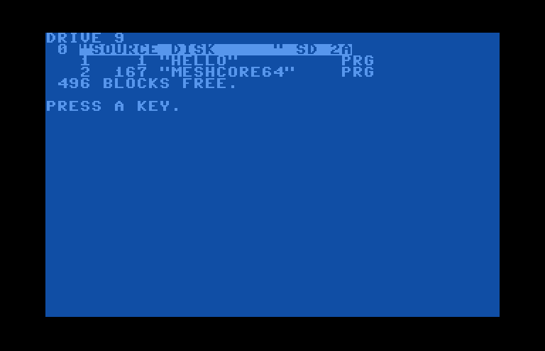
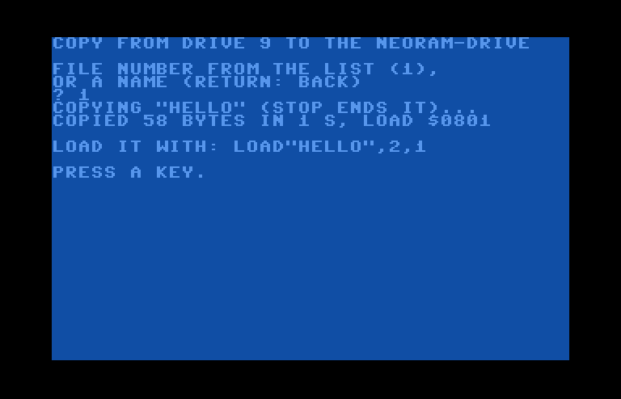
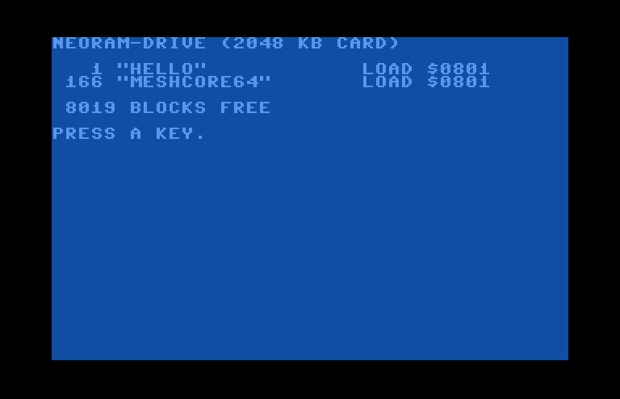

# NeoRAM utils: GeoRAM / NeoRAM tools for the C64

One disk, two tools for a **GeoRAM**, **NeoRAM** or compatible RAM expansion (such as the
**NeoRAM Remix** or an Ultimate II+'s GeoRAM emulation):

- **GEODIAG 1.4** tests the card. It finds the size, checks every data line and both registers,
  tests every byte, and for a bad card says **which RAM chip and which pins** are not making contact,
  with a drawing of the chip.
- **NEOCOPY 1.1** does everything for enthusi's **NeoRAM-Drive** (the card as a battery-backed disk
  drive, device 2) in one program: **install** the drive on the card, **format** it, **list** the source
  drive, **copy** files onto the card, and **start** the drive.

<p align="center"></p>

## Quick start

1. Get [`release/neoram-utils.d64`](release/neoram-utils.d64) onto a drive (a real disk, an SD2IEC,
   an Ultimate's drive emulation).
2. `LOAD"*",8` and `RUN` (use your drive number in place of 8).
3. The menu: **1** starts GEODIAG, **2** starts NEOCOPY. Each is loaded from the same drive.

| file on the disk | what | load it by hand |
|---|---|---|
| `neoram utils` | the menu (first on the disk) | `LOAD"*",8` |
| `geodiag` | GEODIAG for C64 mode | `LOAD"GEODIAG",8` |
| `neocopy` | NEOCOPY | `LOAD"NEOCOPY",8` |
| `geodiag128` | GEODIAG for **C128 mode** (adds a full test at 2 MHz) | `LOAD"GEODIAG128",8` in C128 mode |

The same programs are in [`release/`](release) as PRGs (`geodiag64-v1.4.prg`, `geodiag128-v1.4.prg`,
`neocopy-v1.1.prg`), with their BASIC listings.

**On an Ultimate II+ with its I/O lines switched off** (for example on an expansion port expander, so
a real GeoRAM can use `$DE00`-`$DFFF`), the Ultimate cannot run a PRG directly: mount the D64 and load
from its drive instead.

---

## GEODIAG

At start it runs the **quick checks** and reports them in plain words:

- **Raw reads** of `$DE00`-`$DE07` and the registers, before anything is written.
- **Data lines D0-D7**: does each one store both a 0 and a 1? A card that stores nothing is reported as
  "no card is answering".
- **Page register** (bits 0-5): does each bit select memory of its own?
- **Block register** (bits 0-7): finds where memory ends (the size: 512 KB, 1 MB, 2 MB or 4 MB) and any hole.

Then the menu:

| key | test | the card's contents |
|---|---|---|
| `1` | **test all RAM pins**, each chip in turn: see below. Start here | kept |
| `2` | **full test**, every byte: each page is saved, filled with `$55`, `$AA` and an address pattern, checked and put back | kept |
| `3` | the same at **2 MHz** (C128 only, FAST mode) | kept |
| `4` | **read stability**: one byte read 65536 times, counting reads that differ from the first | kept |
| `5` | **look at a page** in hex | kept |
| `6` | the quick checks again | kept |
| `7` | **whole-card test**: every byte gets a value of its own, and only then is it all read back, so a write that lands in the wrong place shows. Twice (the second time inverted), then 65536 random accesses; repeats until STOP | **erased** |
| `8` | **retention, step 1**: writes a pattern over the whole card and checks it. Then turn the machine off | **erased** |
| `9` | **retention, step 2**: after power comes back, checks what the card kept, and says whether it points to the battery, one chip, or a stray write | checked |
| `Q` | quit | |

Everything tests 1-6 write is saved first and put back, so a NeoRAM keeps its contents (the battery
holds them through a power-off). The error report lists the error count, glitches (wrong on one read,
right on the next), which data bits were wrong, the first 16 errors (block, page, offset, wrote, read)
and a map of the blocks with errors.

### Test all RAM pins (menu 1)

A card is built from 512 KB chips, one per 32 blocks. Menu 1 writes one byte in each chip with walking
1s and 0s (twice) and its own value, and reports each chip:

- `ok`;
- `same chip as U1`: the card ends here, or a block select line is stuck;
- `reads back wrong`;
- `no data at all`: the chip is not selected or has no power;
- **`1 pin not connecting:`** followed by each pin, where it is on the chip, and what to do about it.

Here it is on a 2 MB card whose U2 has pin 17 (D0) open. (A simulated fault: these screenshots come
from VICE with a test build of GEODIAG that reports D0 bad on the second chip.)

<p align="center"></p>

A key then shows each faulty chip from above, the bad pins as solid blocks:

<p align="center"></p>

Chip names (U1-U8) and pin numbers are for the **NeoRAM Remix**, a 32-pin RAM (AS6C4008-style, 512K x 8)
per 512 KB. Its data lines are not wired in order, so GEODIAG translates the C64 data bit to the chip pin:

| C64 data bit | D0 | D1 | D2 | D3 | D4 | D5 | D6 | D7 |
|---|---|---|---|---|---|---|---|---|
| RAM pin | 17 | 15 | 18 | 14 | 19 | 13 | 20 | 21 |

Reflow each pin it names, with flux, pressing the lead down onto its pad. With a meter, the lead itself
(not its pad) should beep through to the same pin on a good chip. On other cards the data bit is still
right, but the chip names and pin numbers may not be.

It was written to find real faults: on a 2 MB NeoRAM Remix it named U2 pins 17-19 and U4 pins 14-15 as
open, and after those joints were reflowed every chip passed.

### Retention (menus 8 and 9)

Step 1 fills the card and checks it right away. Turn the machine off for a minute, an hour or a night,
then load GEODIAG again and choose 9. If almost nothing was kept, backup power did not hold: check the
battery (2.8 V or more, and the right way round), the diode, and that SJ5 is open; with the machine off,
RAM pin 32 should read about the battery voltage less 0.3 V, and pin 22 about the same. Bits flipped
all over the card point to a low or dipping backup voltage or a chip that is not a low-power (L/LL) part;
one chip alone points to that chip or its pin 32 joint.

---

## NEOCOPY

[NeoRAM-Drive](third_party/neoram-drive) V0.40 by enthusi turns the card into a disk drive that keeps
its files through a power-off: `LOAD"$",2` lists it, `LOAD"FILE",2,1` loads, `SAVE"FILE",2` saves, and
`SYS 57000` starts it after a reset. NEOCOPY carries the drive inside it, so nothing else is needed.

<p align="center"></p>

The top lines show the card's size and the drive's state: `not on the card (5)`, `on the card, not
started`, or `running as device 2`.

| key | does |
|---|---|
| `1` | **list the source drive**: its directory, numbered, so a file can be copied by its number |
| `2` | **copy a file** from the source drive onto the NeoRAM-Drive, by number or by name (PRG files) |
| `3` | **list the NeoRAM-Drive**: each file's size and load address, and the blocks free |
| `4` | **start** the NeoRAM-Drive (`SYS 57000`); it answers as device 2 |
| `5` | **install** the NeoRAM-Drive on the card: its 7 pages, every byte read back, then offers to format |
| `6` | **format** the NeoRAM-Drive: every file on it is lost (the drive itself stays) |
| `7` | change the source drive (it starts as the drive NEOCOPY was loaded from) |
| `Q` | quit |

On a new card: **5** (install, and format when it asks), **4** (start), **7** if your files are on
another drive, **1** to list them, **2** to copy. Then quit and use the card as drive 2. After a reset or
power-on, `SYS 57000` starts the drive again.

<p align="center">
</p>

<p align="center"></p>

**How it copies.** It does not LOAD a file and SAVE it again: that would land on top of NEOCOPY for
anything that does not load at `$0801`. Instead it reads the file with OPEN/GET and writes it straight
into the drive's own layout on the card (files from `$0700` on, each with a 3-byte link, its name and its
load address). The new end of the list is written last, so a copy that fails part way, or is stopped with
STOP, leaves the drive as it was. A file that would reach `$CA00`, where the drive runs, is copied but
flagged: it cannot be loaded from the drive.

**It shares the card with nothing else.** The drive takes the card's first 7 pages and `SYS 57000`, and
its files fill the card from `$0700` up. Installing or formatting it replaces what other GeoRAM
software keeps there: MeshCore 64's app and session, Maniac Mansion GOLD, Neotunes. NEOCOPY's install
screen says so before it writes.

---

## How a GeoRAM works

A 256-byte window at `$DE00`-`$DEFF` shows one page of the card. `$DFFE` selects the page (0-63) within
a 16 KB block, and `$DFFF` selects the block (0-255, so up to 4 MB). Both registers are write-only.
`SYS 57000` jumps to `$DEA8`, which is in the window: whatever program keeps a starter on the card's
first page (block 0, page 0) owns it.

## Building

```bash
./build.sh            # -> release/: the D64, the PRGs, the BASIC listings and md5.txt
```

Needs python3 and VICE's `petcat` and `c1541`. Each tool is a BASIC program with a small 6502 helper in
DATA lines after it, built by a Python script:

- [`src/mkgeodiag.py`](src/mkgeodiag.py): GEODIAG, helper at `$C000` (C64) or `$1300` (C128).
- [`src/mkneocopy.py`](src/mkneocopy.py): NEOCOPY, helper at `$C000`; the NeoRAM-Drive's 7 pages follow
  as DATA, taken from [`third_party/neoram-drive/neoramdrive-040.prg`](third_party/neoram-drive) exactly
  as its own installer would write them.
- [`src/mkmenu.py`](src/mkmenu.py): the menu, with a loader in the cassette buffer that loads and RUNs
  the chosen program.

[`src/asm.py`](src/asm.py) is the small assembler from [MeshCore 64](https://github.com/pskerrett/meshcore64).
The build is reproducible: it gives the files in `release/` byte for byte.

## Tested

- VICE (C64), GEODIAG: GeoRAMs of 512 KB and 2 MB, menu keys 1-5, and a data line fault injected into
  one chip (the screenshots above).
- VICE (C64), NEOCOPY: on a blank 2 MB GeoRAM, install, format, start, a source disk on drive 9 listed,
  a small BASIC program and a 42 KB program copied, the drive listed, then `LOAD"$",2` and the copied
  program loaded and RUN from device 2. The menu loads both tools.
- A real C64 with two 2 MB NeoRAM Remix cards (GEODIAG 1.3): one with a battery holder fitted backwards
  (found by the retention test), one with open data pin joints (found by the RAM pin test).

## Credits and licence

NeoRAM-Drive V0.40 is © 2007, 2008 Martin Wendt / enthusi (Onslaught), released under the GNU General
Public License v3 or later ([csdb.dk/release/?id=61122](https://csdb.dk/release/?id=61122)). Its source,
program, README and licence are in [`third_party/neoram-drive`](third_party/neoram-drive), unchanged.
NEOCOPY contains the drive, so NEOCOPY is distributed under the same licence, GPL v3 or later
([`COPYING`](third_party/neoram-drive/COPYING)).
